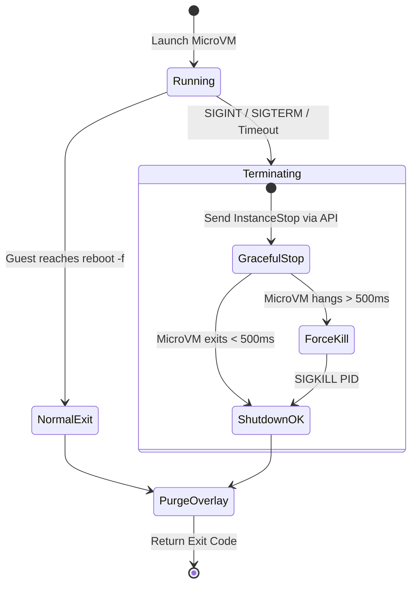

# Architecture & Internals

`ephemvm` combines AWS Firecracker, the Linux KVM hypervisor interface, copy-on-write storage techniques, and real-time serial streaming into a single, high-performance binary.

---

## Architectural Overview


---

## MicroVM Lifecycle Sequence

The following sequence illustrates the exact execution lifecycle from the moment `ephemvm` is invoked in your shell until its complete evaporation:

```mermaid
sequenceDiagram
    autonumber
    actor User as Host Shell
    participant CLI as ephemvm CLI
    participant AssetMgr as Asset Manager (~/.cache)
    participant Storage as CoW Allocator (/tmp)
    participant KVM as Linux KVM (/dev/kvm)
    participant FC as Firecracker MicroVM
    participant Serial as Serial Console (ttyS0)

    User->>CLI: ephemvm run -- <cmd>
    CLI->>AssetMgr: Ensure vmlinux & rootfs exist (verify SHA256)
    AssetMgr-->>CLI: Assets Verified (Read-Only)

    CLI->>Storage: Allocate /tmp/ephemvm-<uuid>/
    CLI->>Storage: FICLONE (reflink) rootfs to overlay.ext4
    Storage-->>CLI: Instant CoW overlay ready (0 copied blocks)

    CLI->>FC: Spawn Firecracker process with Unix API socket
    CLI->>FC: Configure vCPUs, RAM & attach overlay.ext4
    CLI->>FC: Set boot args (init=/bin/sh -- -c "<cmd>; echo __EXIT_CODE:$?__; reboot -f")

    CLI->>FC: Send InstanceStart action via API socket
    FC->>KVM: Boot uncompressed guest kernel (< 50ms)

    activate FC
    KVM->>FC: Guest runs command in hardware isolation
    FC->>Serial: Unbuffered stdout/stderr
    Serial->>CLI: Stream bytes through Sliding ConsoleFilter
    CLI->>User: Display unbuffered output in real-time

    FC->>Serial: Emits __EXIT_CODE:<exit_code>__ & reboots
    deactivate FC

    CLI->>CLI: Suppress sentinel string & extract integer exit code
    CLI->>FC: MicroVM halts / StopVMM()
    CLI->>Storage: Deferred cleanup: permanently purge /tmp/ephemvm-<uuid>/
    CLI-->>User: Return guest exit code to host shell
```

---

## Storage & Copy-on-Write (CoW) Overlays

One of the biggest performance bottlenecks in traditional virtualization is disk provisioning. `ephemvm` achieves near-zero disk latency and zero risk of base image corruption using a two-tier storage model.

```
+-------------------------------------------------------------------------+
|                  HOST BASE CACHE (~/.cache/ephemvm/)                    |
|                                                                         |
|   vmlinux (Uncompressed Kernel)              rootfs.ext4 (Base Image)   |
|   Permissions: 0444 (Strict Read-Only)       Permissions: 0444          |
+----------------------------------------------------+--------------------+
                                                     |
                                    Instant Reflink  | (FICLONE ioctl)
                                    0 copied blocks  |
                                                     v
+----------------------------------------------------+--------------------+
|                EPHEMERAL RUN DIR (/tmp/ephemvm-<uuid>/)                 |
|                                                                         |
|   overlay.ext4 (Writable CoW Disk)           firecracker.sock (IPC)     |
|   Only modified disk blocks written          API Control Socket         |
+-------------------------------------------------------------------------+
                                                     |
                                   Process Exit      | Guaranteed Deferred
                                   or Interruption   | Cleanup
                                                     v
                                              💥 DELETED (unlink)
```

### 1. Cryptographic Base Image Protection
The base kernel (`vmlinux`) and root filesystem (`rootfs.ext4`) reside in `~/.cache/ephemvm/` with strict read-only permissions (`0444`). The base image is **never opened in write mode** or attached directly to Firecracker. Even if a process running as root inside the guest executes a disk-level write, it only alters the temporary overlay.

### 2. Instant Reflink Clones (`FICLONE`)
When running on modern Linux filesystems supporting block-level cloning (such as **Btrfs**, **XFS** formatted with reflink support, or **ZFS** with block cloning), `ephemvm` invokes the `FICLONE` ioctl:

$$\text{ioctl}(dst\_fd, FICLONE, src\_fd)$$

- **Latency:** Less than **1 millisecond**.
- **Disk Usage:** **0 bytes** of physical disk blocks allocated at creation time.
- **Mechanism:** The filesystem points inode pointers to existing data blocks. Only blocks modified by guest commands allocate new physical storage (Copy-on-Write).

### 3. High-Speed Sparse Fallback
If the host filesystem does not support `FICLONE`, `ephemvm` falls back to a sparse block scanner:
- The base image is read in 64KB blocks.
- Consecutive zero bytes are skipped via `Seek` rather than written.
- This preserves sparse file allocation and clones the 32MB rootfs in under 5 milliseconds without thrashing host NVMe or SSD storage.

### 4. Guaranteed Ephemeral Teardown
The entire run directory `/tmp/ephemvm-<uuid>/` is registered with a deferred cleanup handler (`defer os.RemoveAll(workDir)`). Whether the command succeeds, fails, encounters a panic, or is aborted by `SIGINT` (Ctrl+C), all disk overlays and API sockets are permanently purged.

---

## Exit Code Sentinel Protocol

Most virtualization systems require guest agents, background SSH daemons, or heavy gRPC services to retrieve a command's exit code. This introduces latency, dependencies, and potential attack surfaces.

`ephemvm` eliminates guest agents completely using a **Serial Sentinel Protocol**:

### Guest Boot Specification
The Linux kernel is booted with instructions to execute `/bin/sh` as PID 1:

```bash
console=ttyS0 reboot=k panic=1 pci=off init=/bin/sh -- -c "<cmd>; echo __EXIT_CODE:$?__; reboot -f"
```

1. **Execution:** The guest shell runs `<cmd>`.
2. **Sentinel Emission:** Once the command completes, the shell captures `$?` and prints `__EXIT_CODE:<exit_code>__` to the serial console.
3. **Instant Reboot:** It triggers `reboot -f`, causing Firecracker's virtual CPU to exit immediately.

### Sliding-Window Console Filter
Because serial UART output is streamed over raw byte pipes, the sentinel string can be fractured across packet boundaries (e.g. `__EXIT_` in chunk 1 and `CODE:0__` in chunk 2).

`ephemvm` implements a thread-safe **ConsoleFilter** using a rolling ring buffer:
- Scans all output chunks for partial prefix matches of the sentinel token.
- Withholds potential sentinel bytes until disambiguated.
- Forwards genuine command output unbuffered directly to host `os.Stdout`.
- Transparently strips the sentinel token from terminal display and captures the numeric exit code.

```
Incoming Serial Chunks:
  [ Chunk A: "Hello World\n__EXIT" ]  --> Forwards: "Hello World\n"
  [ Chunk B: "_CODE:0__\n"         ]  --> Detects match! Suppresses token, parses 0.
```

---

## SRE Watchdog & Signal Trapping

To prevent orphaned Firecracker processes or runaway microVMs, `ephemvm` installs an active lifecycle supervisor:



1. **Signal Trapping:** Intercepts `os.Interrupt`, `SIGTERM`, and `SIGQUIT`.
2. **Graceful API Halt:** Sends an asynchronous `InstanceStop` signal to Firecracker's Unix API socket.
3. **Hard 500ms Watchdog:** If Firecracker does not terminate within 500ms, the watchdog sends `SIGKILL` directly to the Firecracker process ID.
4. **Overlay Purge:** The deferred cleanup function is executed, guaranteeing zero resource leakage.
