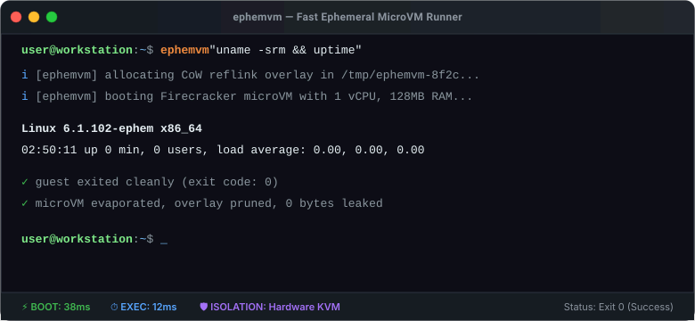

# Getting Started

Get up and running with `ephemvm` in less than two minutes.

---

## System Requirements

`ephemvm` relies on Linux KVM (Kernel-based Virtual Machine) for hardware-accelerated microVM execution.

| Requirement | Minimum | Recommended |
| :--- | :--- | :--- |
| **Operating System** | Linux (Kernel 4.14+) | Modern Linux (Ubuntu 22.04+, Debian 12+, Fedora 38+, Arch) |
| **Hardware** | x86_64 or aarch64 (ARM64) | VT-x / AMD-V enabled in BIOS |
| **Hypervisor Device** | `/dev/kvm` accessible | Dedicated non-root user in `kvm` group |
| **Firecracker Binary** | v1.0.0+ | Automatically downloaded or placed in `PATH` |

> [!NOTE]
> **macOS & Windows Users:**
> `ephemvm` CLI binaries can be compiled on macOS and Windows for testing flags, formatting commands, and managing remote workflows. However, running microVMs requires access to a Linux host with `/dev/kvm` (such as a Linux VM with nested virtualization enabled, an AWS EC2 instance like `c5.metal` or bare-metal server, or a local Linux machine).

### Verify KVM Access

Ensure that hardware virtualization is enabled and your user account has permission to read and write to `/dev/kvm`:

```bash
# Verify KVM device exists and is accessible
test -r /dev/kvm && test -w /dev/kvm && echo "✅ KVM is ready!" || echo "❌ KVM access required"
```

If you receive a permission error:

```bash
# Add your user to the kvm group
sudo usermod -aG kvm $USER

# Apply group changes immediately (or log out and back in)
newgrp kvm
```

---

## Installation

### Method 1: Pre-Built Static Binary (Recommended)

Download the pre-compiled, statically-linked binary for your CPU architecture from the [GitHub Releases](https://github.com/smford/ephemvm/releases) page:

#### For x86_64 (Intel / AMD):
```bash
curl -fsSL https://github.com/smford/ephemvm/releases/latest/download/ephemvm_0.1.1_linux_amd64.tar.gz | tar -xz
sudo install -m 755 ephemvm /usr/local/bin/ephemvm
rm ephemvm
```

#### For ARM64 (AWS Graviton, Ampere, Raspberry Pi 5):
```bash
curl -fsSL https://github.com/smford/ephemvm/releases/latest/download/ephemvm_0.1.1_linux_arm64.tar.gz | tar -xz
sudo install -m 755 ephemvm /usr/local/bin/ephemvm
rm ephemvm
```

Verify your installation:
```bash
ephemvm version
```

---

### Method 2: Homebrew

If you use Homebrew on Linux:

```bash
brew tap smford/tap
brew install ephemvm
```

---

### Method 3: Build from Source

Building requires Go 1.22+ and `make`:

```bash
git clone https://github.com/smford/ephemvm.git
cd ephemvm
make all
sudo make install
```

---

## Your First Ephemeral Command

Running a command inside a dedicated microVM requires zero setup:

```bash
ephemvm "uname -a && uptime"
```



### What Happens Behind the Scenes:
1. **Asset Resolution:** If not already present, `ephemvm` automatically downloads the stripped minimal Linux guest kernel (`vmlinux`) and base filesystem (`rootfs.ext4`) into `~/.cache/ephemvm/` and validates their SHA256 signatures.
2. **Copy-on-Write Clone:** A temporary overlay is instantly created in `/tmp/ephemvm-<uuid>/` using Linux `FICLONE` (reflink).
3. **MicroVM Boot:** Firecracker initializes a hardware-virtualized guest machine in ~35ms.
4. **Command Execution:** The guest shell executes `uname -a && uptime` and streams output directly to your terminal.
5. **Instant Destruction:** Firecracker terminates, and the temporary overlay is deleted from disk.

---

## Useful Starter Commands

### Check Kernel & Distribution
```bash
ephemvm "cat /etc/os-release | head -n 4"
```

### Run an Isolated Multi-Line Script
```bash
ephemvm run -s - << 'EOF'
echo "=== Host Hardware Exposed to MicroVM ==="
lscpu | grep 'Model name'
free -h
EOF
```

### Inspect Asset Cache
Pre-warm your cache for air-gapped environments or offline execution:
```bash
ephemvm cache status
ephemvm cache pull
```

---

## Next Steps

- Dive into [Architecture & Internals](architecture.md) to understand copy-on-write storage and the sentinel protocol.
- Check out [Worked Examples](worked-examples.md) for AI sandboxing, CI/CD runners, and destructive scripts.
- Browse the full [CLI Reference](cli-reference.md) for all execution flags and JSON options.
