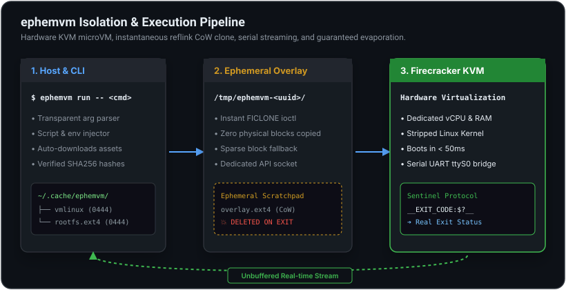

# ephemvm

<p align="center">
  <strong>A blazing-fast, disposable Linux machine for running any command in total isolation.</strong><br>
  Boots in under <strong>50ms</strong> via hardware virtualization, runs your command, forwards the exit code, and evaporates instantly without leaving a trace.
</p>

<p align="center">
  <a href="https://github.com/smford/ephemvm/actions/workflows/ci.yml"></a>
  <a href="https://github.com/smford/ephemvm/releases"></a>
  <a href="https://goreportcard.com/report/github.com/smford/ephemvm"></a>
  <a href="https://opensource.org/licenses/MIT"></a>
  
  
</p>

---


---

## The Problem ephemvm Solves

Modern developers, autonomous AI agents, and CI/CD pipelines constantly need to run commands:
- **Running untrusted scripts** downloaded from the internet (`curl | bash`).
- **Autonomous AI agents** (Claude Code, Cursor, MCP tools) executing arbitrary bash commands on your workstation.
- **Destructive test suites** that modify system state, delete configuration files, or format volumes.
- **Build pipelines** that need clean, pristine operating system state on every invocation.

Until now, developers had to choose between two flawed extremes:

```
        Latency                       Isolation Boundary
  Containers (Docker)        ephemvm (Hardware MicroVM)     Traditional VMs (QEMU)
  ─────────────────────      ──────────────────────────     ──────────────────────
  ⚡ 500ms - 2s               ⚡ < 50ms                      🐢 30s - 60s
  ⚠️ Shared Host Kernel       🛡 Dedicated Guest Kernel      🛡 Dedicated Guest Kernel
  ⚠️ Root escape risk         🔒 Hardware boundary           🔒 Hardware boundary
  ⚠️ State leaks in volumes   ✨ 100% Guaranteed Cleanup     ⚠️ Leftover disk images
```

1. **Docker / Containers are NOT a security boundary.** Containers share the host kernel. A kernel exploit or privileged container escape gives attackers direct control over your host machine. Furthermore, containers often leave behind dangling volumes, stopped containers, and modified layers.
2. **Traditional VMs are too slow.** VirtualBox, VMware, and full QEMU take 20 to 60 seconds to boot a full operating system. They consume gigabytes of RAM and cannot be used for snappy, command-by-command workflows.

**`ephemvm` gives you the best of both worlds:**
The **sub-50ms speed** of a lightweight container with the **absolute hardware security** of a full virtual machine.

---

## How It Works

`ephemvm` orchestrates a seamless, multi-stage lifecycle in the blink of an eye:



1. **Read-Only Base Image:** An uncompressed Linux kernel (`vmlinux`) and root filesystem (`rootfs.ext4`) are stored read-only in `~/.cache/ephemvm/`.
2. **Instant CoW Storage:** Using Linux `FICLONE` (reflink), `ephemvm` creates an instant copy-on-write overlay in `/tmp/ephemvm-<uuid>/`. Zero physical disk blocks are duplicated.
3. **Hardware MicroVM Launch:** AWS Firecracker launches over `/dev/kvm` with dedicated vCPU and memory envelopes.
4. **Execution & Real-Time Streaming:** The guest kernel boots directly into your command. Stdout and stderr stream unbuffered to your terminal via the virtual serial console (`ttyS0`).
5. **Exit Code Sentinel Extraction:** When finished, the guest emits an exit code sentinel (`__EXIT_CODE:$?__`). `ephemvm` extracts the code, strips the sentinel from your output, and returns the exact integer status to your host shell.
6. **Total Evaporation:** Firecracker terminates, and the ephemeral overlay is permanently unlinked. **Zero leftover state.**

---

## Feature Comparison

| Capability | Containers (Docker, Podman) | Traditional VMs (VirtualBox, QEMU) | **ephemvm** |
| :--- | :--- | :--- | :--- |
| **Isolation Boundary** | Namespaces & cgroups *(shared kernel)* | Full Hardware Virtualization | **Hardware Virtualization (KVM)** |
| **Boot Latency** | 500ms – 2,000ms | 20,000ms – 60,000ms | **< 50ms** |
| **Host Kernel Protection** | ❌ Panic / CVE affects host | ✅ Isolated | **✅ Completely Isolated** |
| **Host Disk Protection** | ⚠️ Writable layers & bind mounts | ⚠️ Modifies VM disk | **✅ Read-Only Base + Reflink CoW** |
| **Cleanup Guarantee** | ⚠️ Orphan volumes / stopped containers | ⚠️ Disk images persist | **✅ 100% Guaranteed Ephemeral** |
| **Memory Footprint** | ~50MB – 150MB | 1GB – 4GB | **64MB – 128MB** |
| **Direct Command Pass-through** | `docker run ...` (complex flags) | SSH / guest agents required | **`ephemvm "cmd"` (transparent)** |
| **Machine-Readable Telemetry** | Requires custom wrappers | Requires monitoring tools | **Native `--json` flag** |

---

## Highlights at a Glance

### ⚡ Sub-50ms Startup
Stripped down to the bare essentials: no PCI scanning, no ACPI table initialization, and no device probing. Firecracker boots the Linux kernel and initializes `/bin/sh` faster than human reaction time.

### 🛡 Hardware-Enforced Safety
Every command runs within its own hypervisor boundary. Even `rm -rf --no-preserve-root /` or triggering an intentional guest kernel panic will not affect your host machine in any way.

### 🧹 Zero Disk Footprint
All file modifications are trapped inside an ephemeral copy-on-write overlay. The moment execution finishes, deferred cleanup deletes the temporary directory and sockets.

### 🔌 Seamless CLI Integration
Use `ephemvm` just like you would use `bash -c`. Pipe scripts through standard input, pass environment variables, configure hard timeouts, and collect structured JSON telemetry.

---

## Explore the Documentation

<div style="display: grid; grid-template-columns: repeat(auto-fit, minmax(260px, 1fr)); gap: 1.25rem; margin: 2rem 0;">

  <div style="border: 1px solid var(--border); border-radius: 8px; padding: 1.25rem; background: var(--code-bg);">
    <h3 style="margin-top: 0;">🚀 <a href="getting-started.md">Getting Started</a></h3>
    <p>Check host prerequisites, install pre-built binaries or build from source, and run your first isolated microVM command in seconds.</p>
  </div>

  <div style="border: 1px solid var(--border); border-radius: 8px; padding: 1.25rem; background: var(--code-bg);">
    <h3 style="margin-top: 0;">🏛️ <a href="architecture.md">Architecture &amp; Internals</a></h3>
    <p>Learn how copy-on-write reflink storage, serial console stream filtering, and the exit sentinel protocol operate under the hood.</p>
  </div>

  <div style="border: 1px solid var(--border); border-radius: 8px; padding: 1.25rem; background: var(--code-bg);">
    <h3 style="margin-top: 0;">💡 <a href="worked-examples.md">Worked Examples</a></h3>
    <p>Explore step-by-step solutions for AI tool execution, untrusted script inspection, CI/CD telemetry, and destructive teardown tests.</p>
  </div>

  <div style="border: 1px solid var(--border); border-radius: 8px; padding: 1.25rem; background: var(--code-bg);">
    <h3 style="margin-top: 0;">📖 <a href="cli-reference.md">CLI Reference</a></h3>
    <p>Comprehensive reference guide for all flags, environment variables, resource tuning limits, and exit status codes.</p>
  </div>

</div>
